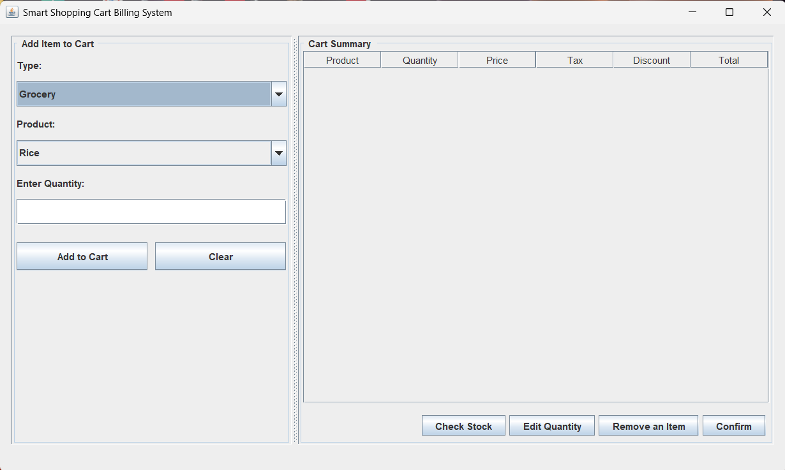
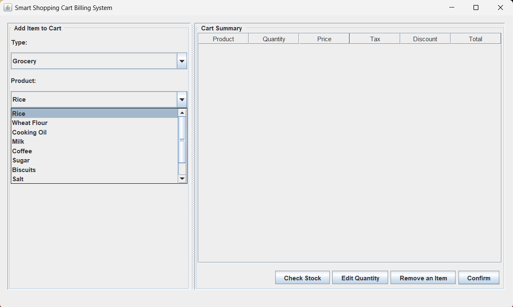
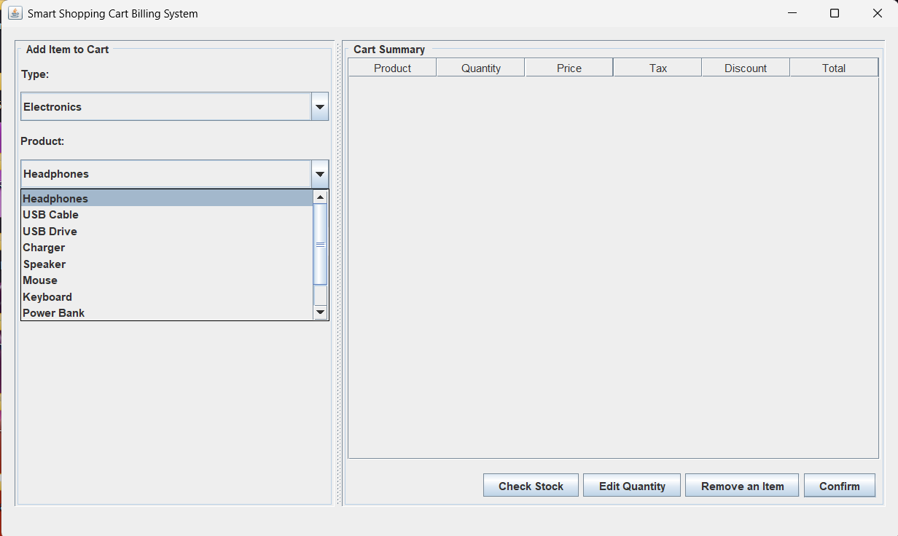
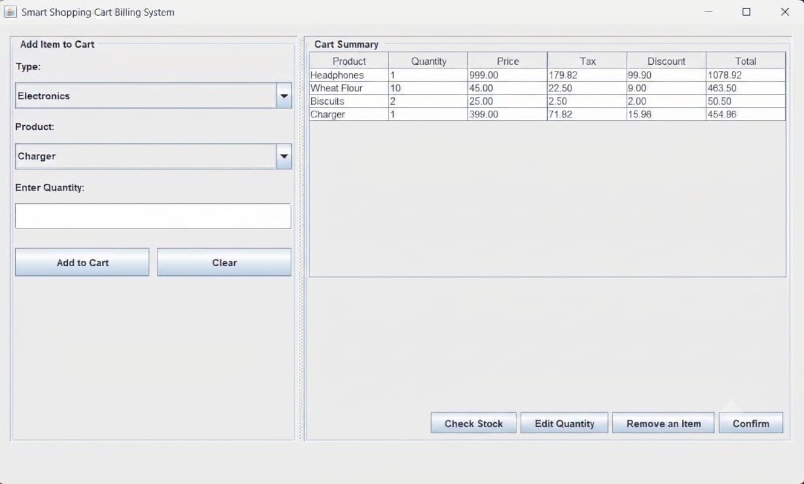
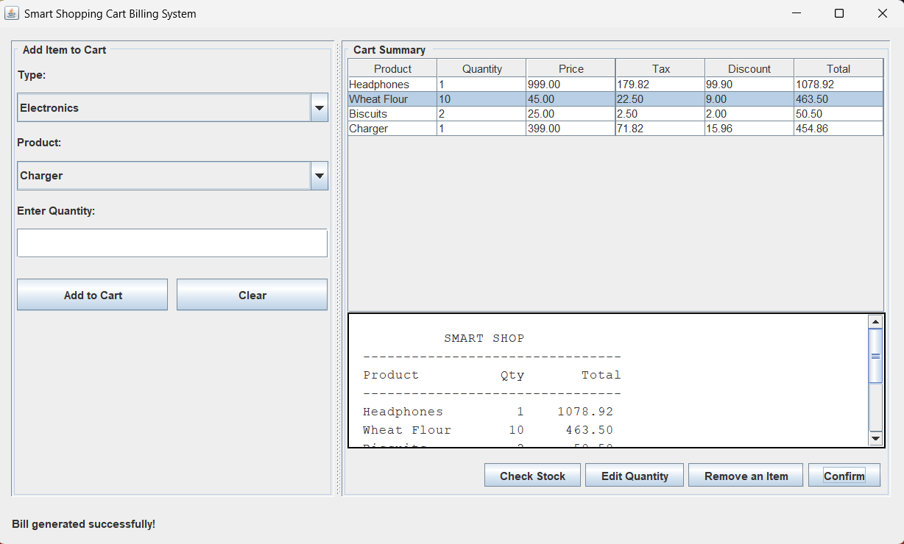
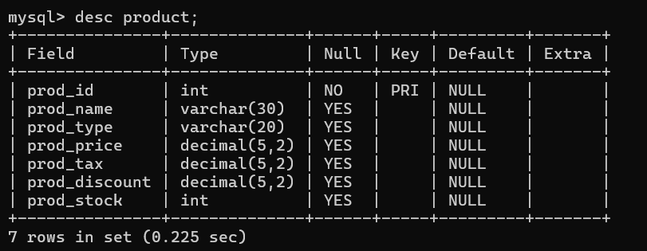
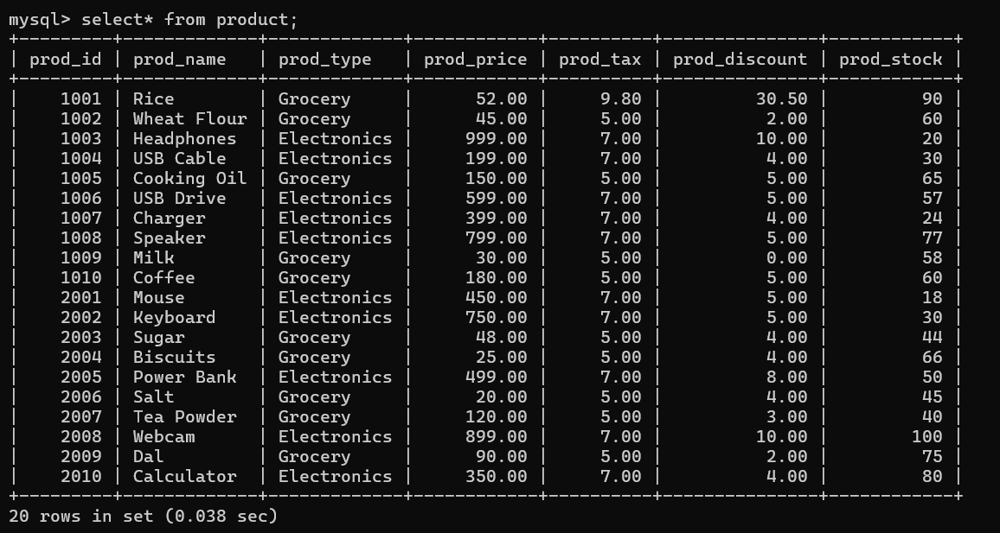

# SmartShopBill – Smart Shopping Cart Billing System

A desktop-based shopping cart and billing application developed using **Java Swing, AWT, JDBC, and MySQL** as part of an Object-Oriented Programming academic project at Saintgits College of Engineering.

SmartShopBill allows users to browse products by category, manage shopping cart items, calculate taxes and discounts, validate product availability, and generate bills through a graphical user interface.

## Table of Contents

## Table of Contents

- [Project Overview](#project-overview)
- [Features](#features)
- [Technologies Used](#technologies-used)
- [Application Screenshots](#application-screenshots)
  - [Main Application Interface](#1-main-application-interface)
  - [Product Selection](#2-product-selection)
  - [Cart Summary](#3-cart-summary)
  - [Available Stock Before Bill Generation](#4-available-stock-before-bill-generation)
  - [Generated Bill](#5-generated-bill)
  - [Available Stock After Bill Generation](#6-available-stock-after-bill-generation)
- [Project Structure](#project-structure)
- [Database Design](#database-design)
  - [Product Table](#product-table)
  - [Database Setup](#database-setup)
  - [Product Table Structure](#product-table-structure-desc-product)
  - [All Product Records](#all-product-records-select--from-product)
- [Billing Calculations](#billing-calculations)
- [Object-Oriented Programming Concepts](#object-oriented-programming-concepts)
- [Prerequisites](#prerequisites)
- [Setup and Installation](#setup-and-installation)
  - [Clone the Repository](#step-1-clone-the-repository)
  - [Configure MySQL](#step-2-configure-mysql)
  - [Configure the Database Connection](#step-3-configure-the-database-connection)
  - [Configure MySQL Connector/J](#step-4-configure-mysql-connectorj)
  - [Compile the Application](#step-5-compile-the-application)
  - [Run the Application](#step-6-run-the-application)
- [How to Use](#how-to-use)
- [Limitations](#limitations)
- [Future Enhancements](#future-enhancements)
- [Project Team](#project-team)

## Project Overview

SmartShopBill is designed to simplify the shopping and billing process by combining a graphical user interface with a MySQL database.

Users can select products from different categories, specify quantities, add items to a cart, modify or remove items, and generate a bill with automatic tax and discount calculations.

The application also checks product availability and updates inventory when a bill is confirmed. Database transactions are used during stock deduction to prevent partial inventory updates when a stock update fails.

## Features

- **Product Categorization:** Browse Grocery and Electronics products.
- **Database Connectivity:** Retrieve product details from MySQL using JDBC.
- **Shopping Cart Management:** Add products and update quantities for existing cart items.
- **Quantity Editing:** Modify the quantity of a selected cart item.
- **Item Removal:** Remove selected products from the cart.
- **Stock Validation:** Check available inventory and prevent purchases exceeding the available stock.
- **Automatic Billing:** Calculate subtotals, taxes, discounts, and final totals.
- **Bill Generation:** Display a bill containing product names, quantities, totals, and the grand total.
- **Inventory Updates:** Deduct purchased quantities from the database after bill confirmation.
- **Transaction Management:** Use database transactions and rollback for stock deduction.
- **Stock Viewer:** Display product IDs, names, and available stock in a separate window.
- **Graphical User Interface:** Provide an interactive desktop application using Java Swing and AWT.
- **Bill Locking:** Prevent modifications to the cart after a bill has been generated until the cart is cleared.

## Technologies Used

| Technology | Purpose |
|---|---|
| Java | Application logic and object-oriented programming |
| Java Swing | Graphical user interface |
| AWT | Layouts, events, and interface components |
| JDBC | Communication between Java and MySQL |
| MySQL | Product and inventory storage |
| SQL | Product retrieval and stock updates |
| PreparedStatement | Parameterized database queries |
| ArrayList | In-memory shopping cart management |
| JTable | Displaying cart items and stock records |
| VS Code | Development environment |

## Application Screenshots

The following sections are reserved for screenshots of the running application. Add your screenshots to the repository's `screenshots/` folder and update the image paths if your filenames differ.

### 1. Main Application Interface

The main window provides product selection, quantity entry, and the cart summary.



### 2. Product Selection

The application allows users to select products from the Grocery and Electronics categories.




### 3. Cart Summary

The cart displays product names, quantities, prices, tax, discounts, and final totals.



### 4. Available Stock before Bill Generation

The stock viewer displays product IDs, product names, and their available inventory.

_Window.png)

### 5. Generated Bill

The generated bill displays purchased items and the final payable amount.



### 6. Available Stock after Bill Generation

The stock viewer displays product IDs, product names, and their available inventory.

_Window.png)

> **Note:** Replace the example screenshot filenames with your actual image filenames. These image links will display the screenshots once the corresponding files are uploaded to GitHub.

## Project Structure

```
SmartShopBill/
├── ProductDemo.java
├── README.md
├── .gitignore
└── ASSETS/
    ├── Main_Window.png
    ├── Grocery_Products_DropDown_Window.png
    ├── Electronics_Products_DropDown_Window.png
    ├── Type_DropDown_Window.png
    ├── Cart_Summary.jpeg
    ├── Edit_Quantity_Window.png
    ├── Stock_(before_confirmation)_Window.png
    ├── Bill_Generation_Window.png
    ├── Stock_(after_confirmation)_Window.png
    ├── Table_Desc.png
    └── Table_Rec.png
    
```

*The structure above is illustrative. Adjust it to match your actual project files.*

## Database Design

The application uses a MySQL database named `shop_prod` and retrieves product information from a table named `Product`.

### Product Table

| Column | Description |
|---|---|
| `prod_id` | Unique product identifier |
| `prod_name` | Name of the product |
| `prod_type` | Product category |
| `prod_price` | Unit price |
| `prod_tax` | Tax percentage |
| `prod_discount` | Discount percentage |
| `prod_stock` | Available stock quantity |

### Database Setup

Create the database and product table using the following SQL commands:

```sql
CREATE DATABASE shop_prod;
USE shop_prod;

CREATE TABLE Product (
    prod_id INT PRIMARY KEY AUTO_INCREMENT,
    prod_name VARCHAR(100) NOT NULL,
    prod_type VARCHAR(50) NOT NULL,
    prod_price DOUBLE NOT NULL,
    prod_tax DOUBLE NOT NULL,
    prod_discount DOUBLE NOT NULL,
    prod_stock INT NOT NULL
);
```

Insert product records into the `Product` table before running the application. Ensure that `prod_type` values match the categories used by the application, such as `Grocery` and `Electronics`.

### Product Table Structure (`DESC Product`)

This screenshot shows the structure of the `Product` table, including column names, data types, and key information.

<!-- Paste your Product table structure image link below -->



---

### All Product Records (`SELECT * FROM Product`)

This screenshot displays all records stored in the `Product` table, including product IDs, names, categories, prices, taxes, discounts, and stock quantities.

<!-- Paste your Product records image link below -->



---

## Billing Calculations

SmartShopBill calculates the amount payable for each cart item using the following formulas.

**1. Subtotal**

Subtotal = Unit Price × Quantity

**2. Tax Amount**

Tax Amount = Subtotal × Tax Percentage / 100

**3. Discount Amount**

Discount Amount = Subtotal × Discount Percentage / 100

**4. Final Product Total**

Final Total = Subtotal + Tax Amount − Discount Amount

**5. Grand Total**

Grand Total = Sum of the final totals of all cart items

These calculations are implemented in the `CartItem` class.

## Object-Oriented Programming Concepts

The project demonstrates several object-oriented programming concepts.

- **Encapsulation:** The `Product` and `CartItem` classes use private fields and public getter methods to control access to object data.
- **Inheritance:** `ProductDemo` extends `JFrame` to create the main application window.
- **Polymorphism:** Method overriding is demonstrated by customizing `isCellEditable()` in `DefaultTableModel`. The application also implements the `ActionListener` interface through `actionPerformed()`.
- **Abstraction:** The `Product` and `CartItem` classes provide methods that represent product information and billing calculations without exposing all implementation details.

## Prerequisites

Ensure that the following software and components are installed:

- Java Development Kit (JDK)
- MySQL Server
- MySQL Connector/J
- Visual Studio Code or another Java-compatible IDE
- A compatible Java extension or build setup

## Setup and Installation

### Step 1: Clone the Repository

```bash
git clone <your-repository-url>
cd SmartShopBill
```

Replace `<your-repository-url>` with your actual GitHub repository URL.

### Step 2: Configure MySQL

Start the MySQL server and create the `shop_prod` database and `Product` table using the SQL commands provided above.

Add sample products to the database.

### Step 3: Configure the Database Connection

Update the database connection fields in `ProductDemo.java` with your local MySQL credentials.

```java
private final String url = "jdbc:mysql://localhost:3306/shop_prod";
private final String user = "your_mysql_username";
private final String pass = "your_mysql_password";
```

**Security:** Never commit your actual database password or other private credentials to a public repository.

### Step 4: Configure MySQL Connector/J

Download MySQL Connector/J and ensure the JAR file is available on your Java classpath.

### Step 5: Compile the Application

On Windows, run the following commands from the project directory, replacing the connector filename with the actual JAR filename:

```bash
javac -cp ".;mysql-connector-j-X.jar" ProductDemo.java
```

### Step 6: Run the Application

```bash
java -cp ".;mysql-connector-j-X.jar" ProductDemo
```

The SmartShopBill application window should open if the database connection and configuration are correct.

## How to Use

1. Launch the application.
2. Select a product category.
3. Choose a product from the dropdown list.
4. Enter a valid quantity.
5. Click **Add to Cart** to add the product.
6. Select a cart row and use **Edit Quantity** or **Remove an Item** when needed.
7. Click **Check Stock** to view the available inventory.
8. Click **Confirm** to generate the bill and deduct the purchased quantities from the database.
9. Click **Clear** to reset the cart and begin a new billing session.

## Limitations

- Product creation and editing are not implemented in the current interface.
- Generated bills are displayed in the application but are not saved to a permanent sales-history table.
- Invoice printing and PDF export are not implemented.
- User authentication and role-based access are not implemented.
- The application does not include payment gateway integration.
- Stock deduction is implemented, but a complete multi-user checkout and payment workflow is outside the current scope.

## Future Enhancements

Potential improvements include:

- Permanent storage of bills and sales history in MySQL.
- Invoice printing and PDF generation.
- User authentication and access control.
- Product search and inventory management.
- Sales reports and billing history.
- Improved concurrent inventory management.
- Integration with a payment processing system.

## Project Team

**Project Developer:** Athira Binu

**Team Members:**
- Angelena Liza Varghese
- Anaina Safeer
- Akhil Thomas Reji

This project was undertaken as a group academic project for the Object-Oriented Programming course at Saintgits College of Engineering.

The implementation and coding of the application were carried out by Athira Binu.

---

*Developed as an academic project for learning and demonstrating Java object-oriented programming, GUI development, and database connectivity.*